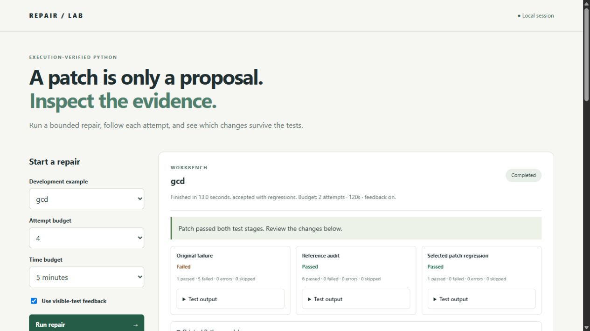

# Execution-Verified Python Code Repair

A reproducible Python repair benchmark that proposes small patches, runs them in
isolated containers, and records the test evidence behind each accepted patch.

The implementation compares bounded AST mutations with a pinned local code model,
with and without retrieved repository context, on 40 QuixBugs tasks. It records
reference-test audits and measured results, including a validation-selected LoRA
adapter trained on verified MBPP repair pairs with resumable checkpoints. A local
browser workbench shows each proposal and its test evidence. Passing available
tests is evidence, not proof of correctness.

## Local workbench

After the [model and runtime setup](docs/WORKBENCH.md), launch the local service:

```sh
python -m repairbench.service --adapter runs/adapter-v2/checkpoint-000117 --output runs/workbench
```

Open **http://127.0.0.1:8018** on the computer running the service. This is a
localhost address, not a public hosted demo. Choose one of eight curated Python
examples, run up to four attempts, cancel an active repair, and inspect the
original failure, candidate modules, rejected responses, ranked patches and final
regression checks. Full evidence can be downloaded as JSON. The service uses
local model weights and executes candidate programs only in the isolated runner.
See [setup, limits and measured integration checks](docs/WORKBENCH.md).



A measured GCD repair with original failures and post-selection test evidence.

## Run an example

Requirements: Python 3.11 and a running local Linux Docker engine with memory,
PID and seccomp controls. Docker Desktop's Linux engine works on Windows.
Image construction and dataset download need internet; candidate execution has
no network. This deterministic example needs no model weights or API keys.

```sh
python -m venv .venv
# Activate .venv using your shell, then:
python -m pip install -r requirements/dev.txt -e .
python -m pip check
repair-bench data
python -c "from pathlib import Path; Path('runs').mkdir(exist_ok=True)"
docker build -f docker/Dockerfile --iidfile runs/image.id .
repair-bench doctor
repair-bench evaluate --tasks gcd --budget 12 --output runs/gcd
```

On PowerShell, activate with `.venv\Scripts\Activate.ps1`; on bash, use
`source .venv/bin/activate`. Each run requires a new output directory. Inspect
`runs/gcd/tasks/gcd.json` for the original failure, attempted changes, accepted
diff, test counts and resource evidence. This CLI example works without the browser service.

## Local code model

[Model setup and reproduction](docs/INFERENCE.md) add a pinned Qwen code model,
MiniLM context embeddings and an exact FAISS index. Inference runs locally;
generated programs run only in the isolated Docker runtime.

```sh
# After installing the model dependencies and downloading pinned weights:
repair-bench compare --tasks gcd breadth_first_search --budget 4 --output runs/model-example
```

The report compares mutations, generation without context, and generation with
retrieved visible tests and helpers. It includes generated text, rejected outputs,
accepted patches, original test evidence, latency and memory measurements.
In the [full measured comparison](docs/MODEL_RESULTS.md), each model variant
resolved **10 of 39 eligible tasks (25.64%)**, versus **4 of 39 (10.26%)** for
mutations at the same four-attempt budget. Retrieval changed which tasks passed
but did not improve the overall rate. Peak model allocation was 4.31 GiB.

## Adapter training

[Training setup and split controls](docs/TRAINING.md) provide a local LoRA
pipeline with verified synthetic bugs, the original MBPP partitions, clone
screening, completion-only loss and checkpoint recovery. Only adapter weights
are updated. Official test tasks remain outside training and validation.
The training evidence is separate from the earlier, unadapted repair comparison;
a lower validation loss alone does not establish better repairs. The [measured run](docs/TRAINING.md#measured-run) completed 117 updates in 129.5 seconds with 4.27 GiB peak GPU allocation, including a checkpoint restart.

In the subsequent [five-arm repair comparison](docs/ADAPTATION.md#measured-results),
the adapted model resolved **21 of 39 eligible tasks (53.85%)** at four attempts,
versus **10 of 39** for each unadapted variant. Adding retrieval to the adapted
model resolved **17 of 39 (43.59%)**. The run took 75.5 minutes with 4.32 GiB peak
GPU allocation. Paired failures, exclusions and raw responses are retained;
these public development results do not establish independent generalization.

## Repair with feedback

The [bounded repair workflow](docs/FEEDBACK.md) compares independent proposals
with test-feedback retries, ranks patches by visible-test results and edit size,
then applies a separate authored regression gate to the selected patch. Both
methods spend the same attempt budget. Regression results never guide generation
or patch selection, and a failed gate cannot trigger another attempt.

```sh
python -m pip install -r requirements/workflow.txt
repair-bench repair --adapter runs/adapter-v2/checkpoint-000117 --tasks gcd --budget 4 --output runs/repair-example
```

Reports include the original failure, each attempted patch, feedback, rankings
and final decision. The local LangGraph workflow disables remote tracing. All
generated programs still run only in the isolated Docker runtime.

In the [measured eight-task development comparison](docs/FEEDBACK.md#measured-comparison),
independent proposals passed both test stages on **6/8 tasks**, versus **5/8**
with feedback. Feedback gained no task and lost `sqrt`; it did not improve
repair success in this sample. The run took 8.31 minutes with 3.09 GiB peak GPU
allocation. Raw failures, rankings and regression decisions are published.

## Evaluation

```sh
repair-bench evaluate --budget 12 --output runs/baseline
```

The recorded run resolves **4 of 39 eligible tasks (10.26%)**, with one
reference-timeout exclusion, at a maximum of 12 candidates per task. That original
measurement is preserved independently of the model comparison.

The baseline changes one expression at a time: comparison boundaries, arithmetic
operators, two-argument call order, or zero/one constants. Candidates follow a
fixed source order, stop at the first passing patch, and never receive reference
solutions. Reference implementations are executed separately to check the tests.
Tasks with broken references or already-passing originals are reported separately.

See [measured results](docs/EVALUATION.md), [data provenance](docs/DATA.md) and
[execution boundaries](docs/SECURITY.md). Reports preserve per-task failures,
exclusions, accepted patches, runtime/image identity and implementation hashes.
This public benchmark cannot establish unseen-code generalization.

## Tests

```sh
python -m pytest -q
```

Actual isolation tests require the image built above. In bash:

```sh
REPAIR_IMAGE_FILE=runs/image.id python -m pytest -q
```

In PowerShell:

```powershell
$env:REPAIR_IMAGE_FILE = 'runs/image.id'
python -m pytest -q
```

Without that variable, Docker tests are explicitly skipped. CI builds the image,
runs the full test suite, and evaluates two actual benchmark tasks.
It also replays a published model-generated patch in the isolated runtime.
GPU generation is measured locally; CI does not download the model weights.
A separate CPU job checks training splits, loss masking and exact LoRA checkpoint
recovery with a tiny randomly initialized model. It also checks adapter/base
generation separation, equal comparison budgets and verified partial-run resume.

## Repository

- `src/repairbench/`: dataset verification, candidate generation, runner and evaluation.
- `docker/`: pinned runtime image and bounded test supervisor.
- `tests/`: unit tests and actual container isolation probes.
- `docs/`: data, security, interpretation and reproduction notes.
- `results/`: published evaluation evidence; downloaded data and local runs stay ignored.

Code is MIT licensed. QuixBugs remains under its upstream terms and attribution;
see [its license](docs/QUIXBUGS-LICENSE.txt). MBPP training data is CC BY 4.0;
see [the attribution and modifications](docs/TRAINING.md#data-and-split-controls).
