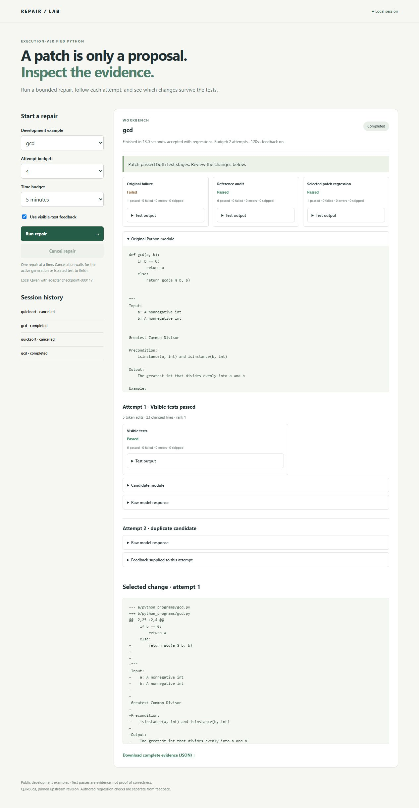

# Local repair workbench

The FastAPI service and TypeScript interface run on the same computer as the
model and Linux Docker engine. They expose eight curated QuixBugs development
examples with authored regression suites. There is no upload endpoint, remote
model API or public hosting. Official MBPP test tasks are not used by this demo.

## Setup

Use Python 3.11 in a separate environment and a running Linux Docker engine.
From the repository root:

```sh
python -m venv .venv
# Activate .venv for your shell.
python -m pip install -r requirements/dev.txt -r requirements/training.txt -e .
python -m pip check
repair-bench data
python -c "from pathlib import Path; Path('runs').mkdir(exist_ok=True)"
docker build -f docker/Dockerfile --iidfile runs/image.id .
repair-bench doctor
repair-bench download-models
```

The pinned weights, licenses and CUDA/CPU instructions are documented in
[INFERENCE.md](INFERENCE.md). The service checks the dataset, local image, model
and optional adapter before accepting requests. To reproduce the adapted mode,
follow [TRAINING.md](TRAINING.md); trained weights are not included in Git.

```sh
# Base model, no adapter training required:
python -m repairbench.service --output runs/workbench-base
# Or the reproduced validation-selected adapter:
python -m repairbench.service --adapter runs/adapter-v2/checkpoint-000117 --output runs/workbench-adapted
```

Open http://127.0.0.1:8018 locally. The service binds only to loopback, uses one
model worker and automatically shuts down after one hour. `--session-seconds`
accepts 60..21600; `--device cpu` is explicit and can be much slower. Ctrl+C
requests cancellation and waits for active operation cleanup. The browser assets
are included in the package; Node is needed only to develop or rebuild them.

```sh
cd frontend
npm ci
npm run build
npx playwright install chromium
npm test
```

## Reading a repair

Select an example, one to four attempts, a time budget, and whether subsequent
proposals receive visible-test feedback. All attempts are spent before ranking.
The workbench shows the original source, original failure, reference audit,
candidate source and raw response, duplicate/invalid-output rejection, test
counts, feedback, edit size, rank, selected diff and post-selection regression.
Reference code and authored regression outcomes never enter the model prompt.

Only `accepted_with_regressions` reports success for these examples. A rejected,
failed, cancelled, interrupted or timed-out job does not provide an accepted
patch. A selected patch can still fail the final gate. These development examples
do not establish unseen-code performance or universal correctness. Feedback did
not improve the [existing development comparison](FEEDBACK.md).

## Bounds and recovery

- One repair runs at a time; additional submissions return HTTP 429, without a queue.
- At most 20 jobs are stored per output directory. At capacity, use a new directory;
  evidence is never silently deleted. Completed records can be viewed after restart.
- A process lock prevents two service instances from sharing an evidence directory.
  Nonterminal records are marked interrupted after restart and are never auto-resumed.
- Requests are limited to 1024 bytes, strict fields, the eight task names, four
  attempts and 10..600 seconds. Model output is capped at 768 tokens and input at
  4096 tokens. Test execution retains the [Docker resource limits](SECURITY.md).
- Cancellation and the job deadline are checked between operations. A currently
  running generation is bounded by tokens, not forcibly interrupted; a running
  isolated test completes or hits its runtime limit before cancellation settles.
  Therefore the requested time budget is not a hard wall-clock guarantee.
- The service requires a same-origin session token on mutations, validates Host
  and Origin, disables CORS, uses a restrictive content policy and renders model
  text as text. Tokens change on restart. It is a local research tool, not an
  authenticated multi-user service or a hostile-code hosting platform.

The output directory contains atomic JSON job records with request limits,
original source, events, full result, timestamps, model/adapter/runtime identity
and implementation hashes. Copy or download completed evidence before deleting
it manually. A machine crash may leave temporary Docker resources; follow the
inspection guidance in [SECURITY.md](SECURITY.md) before reusing the runtime.

## API

`GET /api/config` supplies limits, model identity and a session token.
`POST /api/jobs` accepts `task`, `budget`, `feedback` and `seconds`, with the
`X-Repair-Token` header. Poll `GET /api/jobs/{id}`, request cancellation with
`POST /api/jobs/{id}/cancel`, or download `GET /api/jobs/{id}/export`.
`GET /api/jobs` lists retained jobs; `GET /api/tasks/{name}` returns original source.
Requests from another browser origin or an unexpected Host are rejected.

## Verification

The service tests exercise validation, origin/token/body limits, overlap rejection,
cancellation races, shutdown, failures, capacity, process locking and restart
recovery. A real Docker integration replays one previously published model
response through HTTP and both test stages; it is labeled as a response replay.
Browser tests use an explicitly synthetic fixture for controls, text escaping,
export, history and a 390-pixel layout. Real-model service evidence is recorded
separately; neither fixture nor response replay is a new model-success estimate.

Run verification sequentially, without another benchmark using the Docker
engine. During a simultaneous full-suite and service probe, the reference `sqrt`
regression was classified as a wall timeout despite passing output and exit code
zero. The service's original GCD audit likewise hit the wall bound despite
recording its expected five failures. This caused one suite failure and a strict
probe assertion failure; both diagnostics are retained. The sequential full
suite then passed all 95 tests without changing code or relaxing runtime limits.
The precise cause is unresolved; concurrency is a suspected contributor, not an
established explanation. The earlier [replay discrepancy](FEEDBACK.md) also
remains part of the final reliability review. A timeout fails closed.

The [published integration evidence](../results/workbench-v1/validation.json) records a fresh GCD repair in 12.953 seconds with both test stages passing; a second job cancelled during generation settled in 2.938 seconds and accepted no patch. A simultaneous submission returned 429. The sequential check used the same code and runtime limits.



Captured from the running service after the measured two-attempt GCD job. The form controls start a new job; the result panel records the completed job's actual limits.
